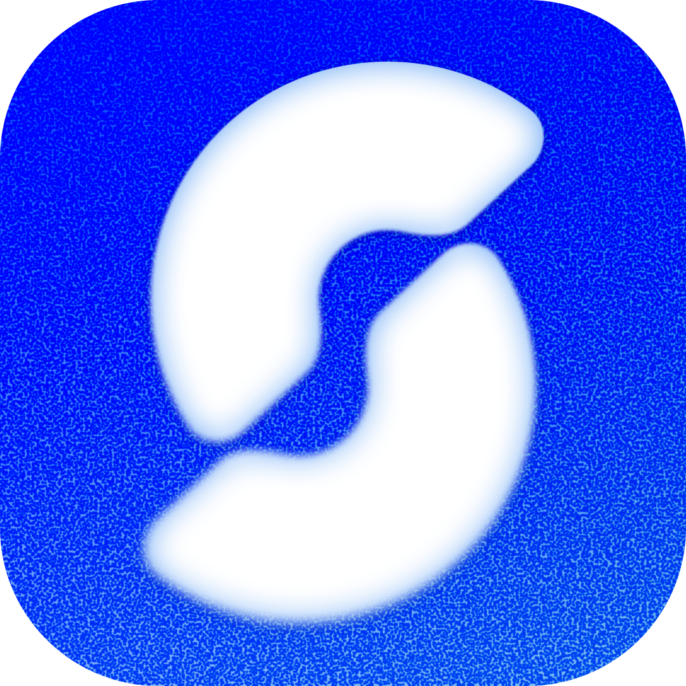
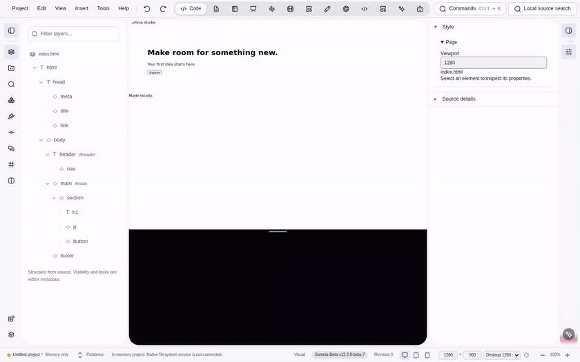
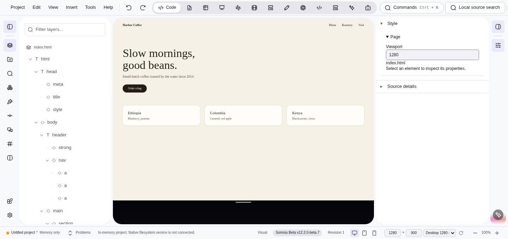
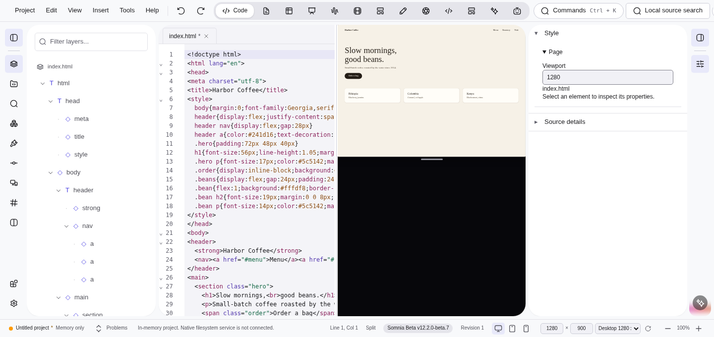
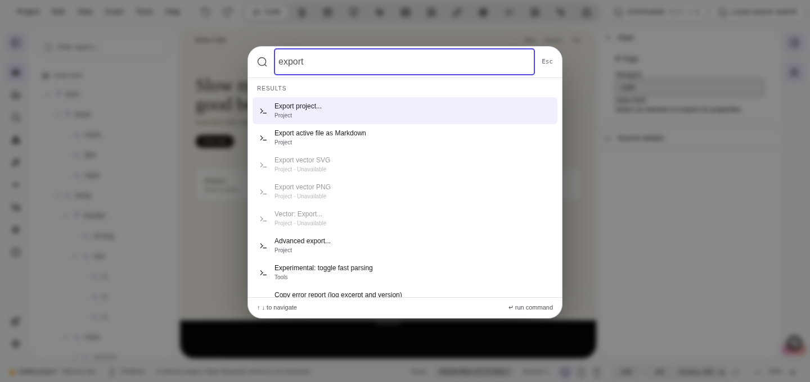
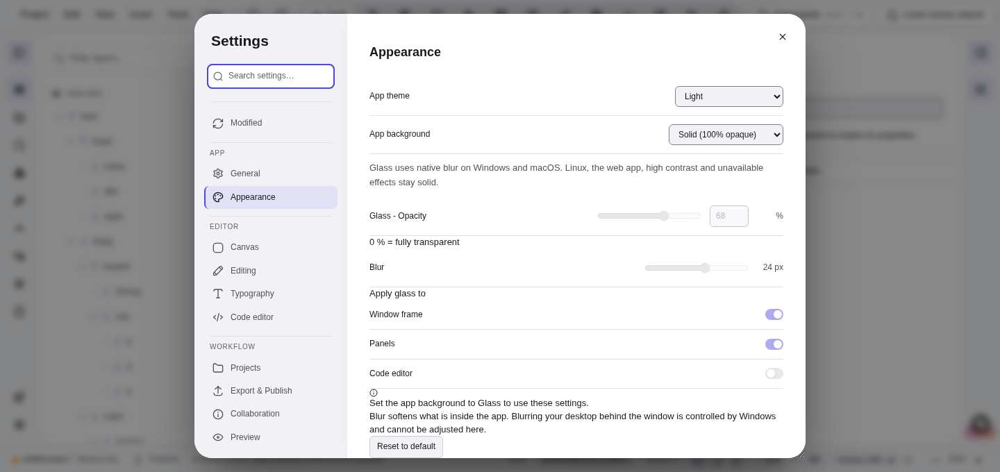

<picture><source media="(prefers-color-scheme: dark)" srcset="docs/assets/brand/somnia-app-icon.png"><source media="(prefers-color-scheme: light)" srcset="docs/assets/brand/somnia-app-icon.png"></picture>

# Somnia

Local-first visual web editor and Dreamweaver successor. Design canvas and code editor on the same source, plus studios for images, vector art, 3D, animation, audio, video and office files. Your files stay on your machine: no account needed, no telemetry. MIT licensed.

**Status: beta.** Current pre-release: [v12.2.0-beta.7](https://github.com/philppplik/somnia/releases/tag/v12.2.0-beta.7). Every release ships from a commit whose full CI matrix is green (frontend e2e, native, Windows, Windows ARM64, macOS, Linux ARM64, CLI). Installers are unsigned for now, so SmartScreen and Gatekeeper can warn. macOS builds are Apple Silicon only.

## What it does today

- **Design and code on one source.** Edits in either place change the real HTML and CSS, with shared undo. Nothing is regenerated. Layers, breadcrumbs, inspector, Problems panel and a command palette (`Ctrl+K`).
- **A studio per craft.** Photos (non-destructive raster editing), Vector (SVG drawing, path booleans, bitmap trace), 3D (models, sculpt, UV tools, GLB export), Animation (keyframes, masks, graphs, GIF/APNG/WebM export), Sound, Video, Documents, Sheets, Slides and an interface builder.
- **Code editor** with Emmet, auto-close tags, linting, find and replace, Prettier formatting (loaded on demand) and a diff viewer.
- **PDF tools:** comments and an AcroForm field designer on copies. XFA forms stay view-only.
- **Crash-safe sessions.** Documents and Sheets write verified recovery checkpoints while you edit and restore them after a crash. Studios you leave in the background suspend and resume from checkpoints; unsaved work is never evicted silently.
- **Transcript Hub:** transcribe audio locally with the optional whisper.cpp helper. No cloud fallback.
- **AI agent (optional):** a native panel that asks before reading or writing each file and shows every change as a preview. OpenRouter, OpenAI, Claude and local Ollama models.
- **Ship your site:** framework adapters (Vite, Astro, Next, SvelteKit, Nuxt, plain Node) and one-click deploy over SSH/SSL, plus the Somnia CLI for scripting. These are experimental.
- **Themes and an extension SDK** (see `docs/extensions/`). Export as ZIP, folder, single HTML file or Markdown.

| Design view | Split view |
| --- | --- |
|  |  |
| **Command palette** | **Settings** |
|  |  |

Tour and screenshots are real captures from the web build (v12.2.0 beta 7).

Architecture: [docs/ARCHITECTURE.md](docs/ARCHITECTURE.md). Build and release: [docs/BUILD-AND-RELEASE.md](docs/BUILD-AND-RELEASE.md). Roadmap: [docs/ROADMAP.md](docs/ROADMAP.md). Benchmarks: [phase1/notes/BENCHMARKS.md](phase1/notes/BENCHMARKS.md).

## AI agent

Cloud processing requires opt-in. AI changes reach the editor only after review and are never saved automatically. Architecture, providers and privacy: [Agent documentation](docs/agent/README.md). Automated tests cover fake providers only so far.

## Download

Get installers from [Releases](https://github.com/philppplik/somnia/releases): Windows (x64 and ARM64), macOS (Apple Silicon) and Linux (x64 and ARM64), plus CLI archives. Every release lists SHA-256 checksums for each file.
